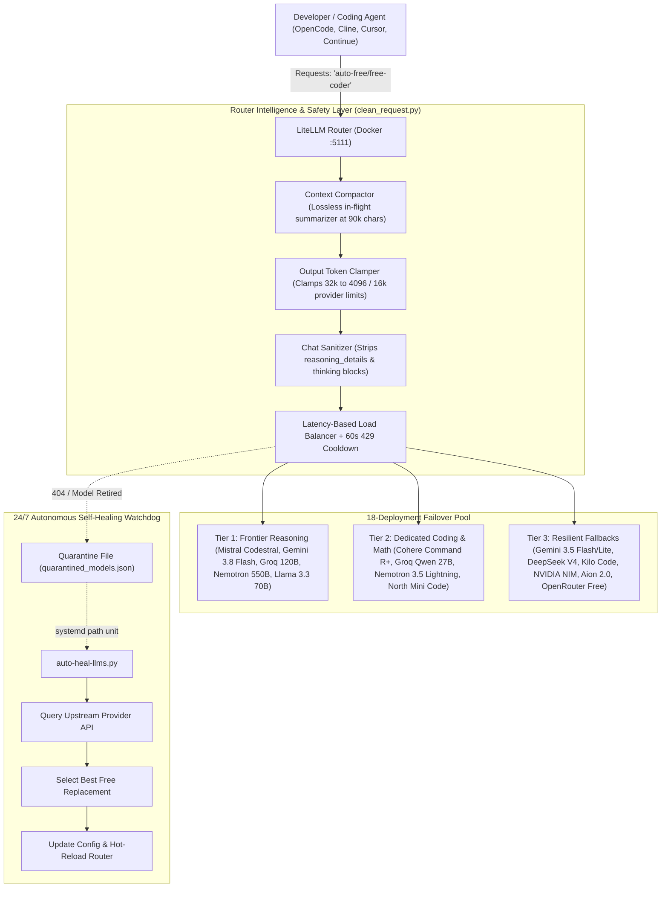

# 🤖 FreeAIRouter

> **Zero-Cost, Multi-Provider AI Coding Hub & Intelligent Failover Proxy**  
> Turn free-tier LLM API keys into a resilient, high-speed, 18-model failover pool for **OpenCode**, **Claude Code**, **Cline**, **Cursor**, **Continue**, **Aider**, or any OpenAI-compatible client.

[](https://opensource.org/licenses/Apache-2.0)
[](https://www.docker.com/)
[](https://github.com/BerriAI/litellm)
[](https://opencode.ai)
[]()

---

## ⚡ Overview

Most free-tier LLM APIs are either rate-limited (HTTP 429), subject to sudden model deprecations (HTTP 404), or restricted by small output token ceilings (e.g. 4096 tokens on Cohere). Standard coding agents typically break when an endpoint rate-limits or overflows.

**FreeAIRouter** solves this by putting a local [LiteLLM](https://github.com/BerriAI/litellm) proxy between your coding agent and 18 free-tier models. Your agent connects to a single virtual model: `auto-free/free-coder` on `http://127.0.0.1:5111/v1`. The router intelligently load-balances across the fastest endpoints, clamps output tokens dynamically, cleans thinking blocks, compacts conversation context in flight, and auto-fails over in milliseconds when limits are hit.

🔗 **Upstream Free Provider Catalog**: [awesome-free-llm-apis](https://github.com/mnfst/awesome-free-llm-apis) — A curated list of free-tier LLM APIs and models.

---

## 🏗️ System Architecture



---

## 🚀 Quickstart (3 Minutes)

### 1. Clone Repository
```bash
git clone https://github.com/michiel2002v/FreeAIRouter.git
cd FreeAIRouter
```

### 2. Configure Your Free Keys
Copy the template and fill in whatever free API keys you have (you **do not** need all keys; the router auto-routes across whichever keys you provide):
```bash
cp .env.example .env
nano .env  # Add your free API keys
```

### 3. Run Automated Setup
```bash
./setup.sh
```
This script automatically:
1. Validates Docker and Docker Compose prerequisites.
2. Launches the LiteLLM container on port `5111`.
3. Installs the `free-ai` CLI companion to `~/.local/bin`.
4. Configures `opencode` to use `auto-free/free-coder`.
5. Performs a live test completion and shows response latency.

---

## 🏆 Active Free Model Roster (Ranked by Intelligence)

The router defaults to `latency-based-routing` across the healthy members of this pool:

| # | Provider | Model ID | Intelligence & Context Strengths |
| :-: | :--- | :--- | :--- |
| **1** | **Mistral AI** | `mistral/codestral-latest` | Premier 256K dedicated code model; Fill-In-The-Middle (FIM) & SOTA code benchmarks |
| **2** | **Google Gemini** | `gemini/gemini-3.8-flash` | Frontier multimodal reasoning with 1,000,000+ token context window |
| **3** | **OpenRouter** | `openrouter/nvidia/nemotron-3-ultra-550b-a55b:free` | **550 Billion parameter** ultra reasoning frontier model; 1,000,000 context |
| **4** | **Groq** | `groq/openai/gpt-oss-120b` | 120B parameter reasoning model running at ultra-low latency (~200ms on Groq LPUs) |
| **5** | **Cloudflare** | `openai/@cf/meta/llama-3.3-70b-instruct-fp8-fast` | 70B parameter frontier open-weights model; 128K context (~500ms via Workers AI) |
| **6** | **Cohere** | `openai/command-r-plus-08-2024` | 104B parameter frontier Command R+ tool model; 128K context (clamped to 4096 output) |
| **7** | **Groq** | `groq/qwen/qwen3.8-27b` | Top-tier algorithmic coding and math reasoning (clamped to 16K output) |
| **8** | **OpenRouter** | `openrouter/nvidia/nemotron-3.5-lightning:free` | 1,000,000 context fast reasoning model |
| **9** | **OpenRouter** | `openrouter/cohere/north-mini-code:free` | Dedicated 256K context free coding model with reasoning support |
| **10** | **Kilo Code** | `openai/kilo-auto/free` | Reflection Beam & community free coding models |
| **11** | **Gonka Broker**| `openai/deepseek-ai/DeepSeek-V4-Flash-0731` | 400K context DeepSeek V4 reasoning (~170ms) |
| **12** | **Google Gemini** | `gemini/gemini-3.5-flash` | Secondary 1,000,000 context frontier fallback |
| **13** | **Google Gemini** | `gemini/gemini-3.5-flash-lite` | Tertiary high-availability context fallback |
| **14** | **Aion Labs** | `openai/aion-labs/aion-2.0` | 128K context reasoning |
| **15** | **Zhipu AI** | `openai/glm-4.7-flash` | 128K context GLM-4.7 Flash reasoning |
| **16** | **Requesty** | `openai/policy/pennytree-free` | Zero-cost policy reasoning model (32K context) |
| **17** | **OpenRouter** | `openrouter/openrouter/free` | Community dynamic free router fallback |

---

## 🛠️ The `free-ai` CLI Companion

FreeAIRouter includes a command-line tool `free-ai` for monitoring and testing:

```bash
# Check router health, container status, and available models
free-ai status

# Run a live completion test against the router and measure response latency
free-ai test

# View the exact model and latency that answered your last prompt
free-ai last

# Stream real-time routing decisions as you code
free-ai watch

# Summarize a large transcript, diff, or file via the fastest frontier model
free-ai summarize large_debug.log

# Manage the Docker Compose router stack
free-ai router restart
free-ai router logs
```

---

## ⚙️ Core Technical Capabilities

### 1. Dynamic Output Token Clamping
Coding agents default to requesting `max_tokens: 32000`. Providers like Cohere reject requests exceeding 4096 output tokens with `HTTP 400 Bad Request`. FreeAIRouter inspects the target deployment right before sending and dynamically clamps `max_tokens` to that provider's limit while allowing larger models (Gemini Flash, Codestral) full generation capacity.

### 2. In-Flight Autonomous Context Compaction
When conversation history grows beyond **90,000 characters** (~22,500 tokens):
- System instructions (`messages[0]`) are preserved verbatim.
- The latest 4 dialogue turns (current prompt and immediate code context) are preserved verbatim.
- Older turns and bulky tool outputs are summarized in flight into an executive markdown summary block.

### 3. Strict Chat Message Sanitization
Reasoning models return non-standard fields like `reasoning_content` or `provider_specific_fields`. Strict non-reasoning providers (Mistral, Cohere) reject these when re-sent in conversation history (`HTTP 422 Unprocessable Entity` or `HTTP 400 thinking content not allowed`). FreeAIRouter cleans every message to strict OpenAI schema, rescuing reasoning text if needed.

### 4. 24/7 Self-Healing Watchdog
When upstream providers retire a free model:
1. **Tier 1 (In-Flight)**: `NotFoundErrorRetries: 3` immediately retries another model in milliseconds.
2. **Tier 2 (In-Memory)**: Defunct models are quarantined in `quarantined_models.json` and excluded from routing.
3. **Tier 3 (Catalog Reconciler)**: Systemd triggers `auto-heal-llms.py` to query provider APIs, select the best active free replacement, update `config.yaml`, and hot-reload LiteLLM.

---

## 🔌 Connecting to Other Coding Tools

FreeAIRouter exposes an OpenAI-compatible endpoint at `http://127.0.0.1:5111/v1`:

### OpenCode
In `~/.config/opencode/opencode.json`:
```json
{
  "$schema": "https://opencode.ai/config.json",
  "providers": {
    "auto-free": {
      "name": "LiteLLM Router",
      "package": "@opencode/ai/providers/openai-compatible",
      "headers": {
        "Authorization": "Bearer sk-free-llm"
      },
      "settings": {
        "baseURL": "http://127.0.0.1:5111/v1"
      },
      "models": {
        "free-coder": { "name": "Free Coder (Auto-Failover)" }
      }
    }
  },
  "model": "auto-free/free-coder"
}
```

### JetBrains Junie CLI
In `~/.junie/config.json`:
```json
{
  "provider": "litellm",
  "model": "gemini-3.8-flash",
  "byok": {
    "litellm": {
      "baseUrl": "http://127.0.0.1:5111",
      "apiKey": "sk-free-llm"
    }
  }
}
```
*Note: Junie validates model names against its catalog. FreeAIRouter aliases `gemini-3.8-flash`, `gemini-3.5-flash-lite`, `gpt`, and `claude-sonnet-4-6` to the full `free-coder` load-balanced pool, and dynamically adapts terminal execution between OpenCode (`shell`) and Junie (`bash`).*

### Cursor / Continue / Cline / Roo Code / Aider
- **Base URL**: `http://127.0.0.1:5111/v1`
- **API Key**: `sk-free-llm` (or any string)
- **Model**: `free-coder` (or `auto-free/free-coder`)

---

## 👥 Multi-User System-Wide Installation

For shared Linux / Ubuntu development servers:
```bash
sudo ./install-systemwide.sh
```
This sets up:
- `/usr/local/bin/opencode` (with deterministic per-user daemon ports `48000 + UID` to prevent port collisions).
- `/usr/local/bin/free-ai` (available to all shell users).
- `/etc/opencode/opencode.json` (system-wide global config).
- `/etc/profile.d/free-ai.sh` (global environment defaults).

---

## 📄 License

Apache 2.0 License — see [LICENSE](LICENSE) for details.
