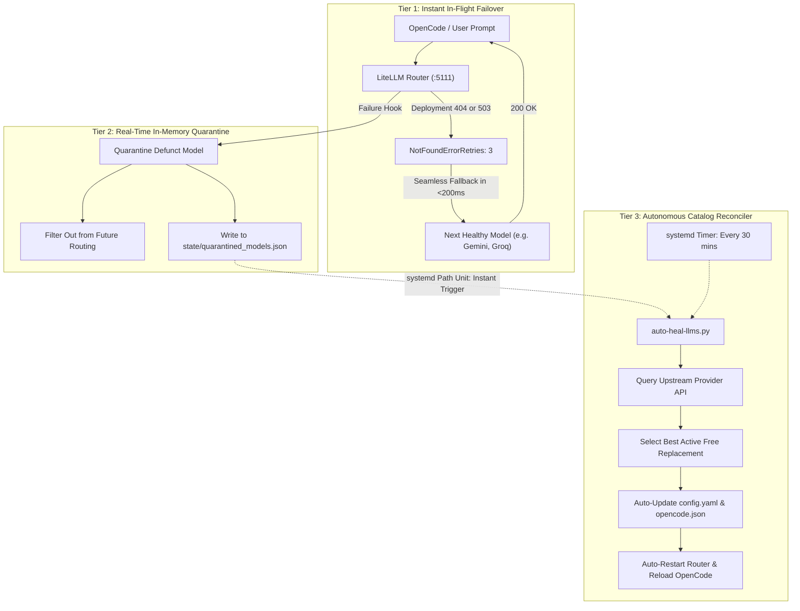

# Free LLM Auto-Routing & OpenCode AI Coding Setup

This document provides a complete, step-by-step walkthrough of the architecture, configuration, tools, and scripts set up to run **OpenCode** seamlessly with an open-source **LiteLLM auto-failover router** across free tier LLM provider keys.

---

## Architecture Overview

```mermaid
flowchart TD
    User["Developer in Terminal"] -->|runs 'opencode'| OC["OpenCode CLI (v2.2.2)"]
    OC -->|Default Model: 'auto-free/free-coder'| LLM["LiteLLM Router (Docker Compose :5111)"]
    
    subgraph Routing ["LiteLLM Failover Engine (Latency-Based + 60s Cooldown & Fallbacks)"]
        direction TB
        LLM --> P1["1. Mistral Codestral (256K FIM Code)"]
        LLM --> P2["2. Google Gemini 3.8 Flash (1M Context Frontier)"]
        LLM --> P3["3. Groq GPT-OSS 120B (~200ms Frontier Reasoning)"]
        LLM --> P4["4. Cohere Command R+ (128K Frontier Tool Model)"]
        LLM --> P5["5. Groq Qwen 3.8 27B (Math & Algorithmic Code)"]
        LLM --> P6["6. OpenRouter Cohere North Mini Code (256K Dedicated Code)"]
        LLM --> P7["7. Kilo Code (Reflection Beam & Free Routers)"]
        LLM --> P8["8. Gonka Broker (DeepSeek V4 Flash 400K)"]
        LLM --> P9["9. Google Gemini 3.5 Flash (Secondary 1M Fallback)"]
        LLM --> P10["10. Google Gemini 3.5 Flash-Lite (Tertiary 1M Fallback)"]
        LLM --> P11["11. NVIDIA NIM (GPT-OSS 20B Fast Reasoning)"]
        LLM --> P12["12. Aion Labs (Aion 2.0 128K Reasoning)"]
        LLM --> P13["13. Zhipu AI (GLM-4.7-Flash Reasoning)"]
        LLM --> P14["14. Requesty (Pennytree Free Tier)"]
        LLM --> P15["15. NVIDIA Nemotron 3 Ultra 550B (1M Context SOTA 550B Reasoning)"]
        LLM --> P16["16. Cloudflare Workers AI Llama 3.3 70B (Frontier 70B Open-Weights)"]
        LLM --> P17["17. NVIDIA Nemotron 3.5 Lightning (1M Context Fast Reasoning)"]
        LLM --> P18["18. OpenRouter (Community Free Dynamic Router)"]
    end
```



Whenever any provider hits a rate limit (`HTTP 429`), upstream model deprecation (`HTTP 404`), or server outage (`HTTP 503`), LiteLLM transparently puts that deployment on a 60-second cooldown and routes the in-flight request to the next highest-ranking model in milliseconds.

---

## 1. Secrets Management & Environment Loading

### `.env` Storage Location
All provider API keys are stored in a private configuration file:
- Path: `~/notepad/free-llms/.env`

> [!IMPORTANT]
> The environment file is kept private and never committed to version control. Keys are parsed dynamically by scripts and containers without hardcoding.

### Environment Variable Standards
The following keys are supported in the `.env` file:
```bash
GROQ_API_KEY="..."           # Groq LPU inference
MISTRAL_API_KEY="..."        # Mistral AI / Codestral
GEMINI_API_KEY="..."         # Google AI Studio / Gemini API
COHERE_API_KEY="..."         # Cohere Platform
NVIDIA_API_KEY="..."         # NVIDIA NIM API
KILO_API_KEY="..."           # Kilo Code Gateway
GONKA_API_KEY="..."          # Gonka Broker
AIONLABS_API_KEY="..."       # Aion Labs
ZAI_API_KEY="..."            # Zhipu AI / Z AI BigModel
REQUESTY_API_KEY="..."       # Requesty Router
OPENROUTER_API_KEY="..."     # OpenRouter API
CLOUDFLARE_API_KEY="..."     # Cloudflare Workers AI Token
CF_ACCOUNT_ID="..."          # Cloudflare Account ID (required for Workers AI)
```

### Auto-Loading Script
To make these keys universally available across your terminal sessions without exposing them, an environment loader was created at [~/.local/bin/load-free-llms.sh](file:///home/michiel/.local/bin/load-free-llms.sh) and added to `~/.bashrc`:

```bash
# Sourced automatically in ~/.bashrc:
if [ -f "$HOME/.local/bin/load-free-llms.sh" ]; then
  . "$HOME/.local/bin/load-free-llms.sh"
fi
```

This script:
1. Sources `~/notepad/free-llms/.env` cleanly.
2. Standardizes SDK aliases (`GOOGLE_API_KEY`, `CF_API_TOKEN`, `AION_API_KEY`).
3. Exports `AUTO_FREE_API_KEY="sk-free-llm"` for the local LiteLLM proxy.
4. Ensures `~/.opencode/bin` and `~/.local/bin` are present in `PATH`.

---

## 2. OpenCode CLI Installation & Configuration

### Installation
OpenCode v2.2.2 was installed natively via the official script:
```bash
curl -fsSL https://opencode.ai/v2/install | bash
ln -sf ~/.opencode/bin/opencode ~/.local/bin/opencode
```
*(Claude Code CLI was uninstalled completely per user requirements).*

### OpenCode Configuration
OpenCode is configured in [~/.config/opencode/opencode.json](file:///home/michiel/.config/opencode/opencode.json):
```json
{
  "$schema": "https://opencode.ai/config.json",
  "providers": {
    "auto-free": {
      "name": "LiteLLM Router (Auto Rate-Limit Fallback)",
      "package": "@opencode/ai/providers/openai-compatible",
      "env": [
        "AUTO_FREE_API_KEY"
      ],
      "headers": {
        "Authorization": "Bearer sk-free-llm"
      },
      "settings": {
        "baseURL": "http://127.0.0.1:5111/v1"
      },
      "models": {
        "free-coder": {
          "name": "Free Coder (Auto-Failover)"
        }
      }
    }
  },
  "model": "auto-free/free-coder"
}
```

Whenever you run `opencode`, it connects to `http://127.0.0.1:5111/v1` and sends requests to the virtual `free-coder` model. Explicit `headers` ensure authentication works reliably even if the OpenCode background daemon launched before shell variables were initialized.

---

## 3. LiteLLM Router (Docker Compose)

LiteLLM ([BerriAI/litellm](https://github.com/BerriAI/litellm)) is an open-source, production-grade LLM proxy. It runs as a Docker container managed by Docker Compose with automatic restart (`unless-stopped`).

### Docker Compose File
Configured at [/home/michiel/ai/docker-compose.yml](file:///home/michiel/ai/docker-compose.yml) (and mirrored in [~/.config/litellm/docker-compose.yml](file:///home/michiel/.config/litellm/docker-compose.yml)):

```yaml
services:
  free-llm-router:
    container_name: free-llm-router
    image: ghcr.io/berriai/litellm:main-latest
    restart: unless-stopped
    ports:
      - "5111:4000"
    volumes:
      - /home/michiel/.config/litellm/config.yaml:/app/config.yaml:ro
      - /home/michiel/.config/litellm/clean_request.py:/app/clean_request.py:ro
      - /home/michiel/.config/litellm/state:/app/state:rw
    environment:
      - GROQ_API_KEY
      - MISTRAL_API_KEY
      - GEMINI_API_KEY
      - NVIDIA_API_KEY
      - OPENROUTER_API_KEY
      - COHERE_API_KEY
      - ZAI_API_KEY
      - KILO_API_KEY
      - GONKA_API_KEY
      - AION_API_KEY
      - REQUESTY_API_KEY
      - CF_API_TOKEN
      - CF_ACCOUNT_ID
    command: ["--config", "/app/config.yaml", "--port", "4000"]
    healthcheck:
      test: ["CMD-SHELL", "python3 -c 'import urllib.request; urllib.request.urlopen(\"http://127.0.0.1:4000/health/readiness\")'"]
      interval: 10s
      timeout: 5s
      retries: 3
      start_period: 5s
```

### LiteLLM Configuration
Configured at [~/.config/litellm/config.yaml](file:///home/michiel/.config/litellm/config.yaml):
- **Strategy**: `latency-based-routing` (favors fastest responding models, transparently routes around slow endpoints).
- **Cooldown**: 60 seconds on `allowed_fails: 1` (rate-limited or broken providers are skipped automatically for 1 minute).
- **Retries**: 5 retries across next available deployments.
- **Hardened Retry Policy**: Retries automatically on `BadRequestErrorRetries: 3`, `RateLimitErrorRetries: 3`, `TimeoutErrorRetries: 3`, `InternalServerErrorRetries: 3`, `ServiceUnavailableErrorRetries: 3`, `NotFoundErrorRetries: 3`, and `DefaultRetries: 3`. This prevents "No fallback was attempted" errors if an upstream provider deprecates a model (`HTTP 404`) or experiences unexpected gateway failures (`HTTP 503`).
- **Sanitizer Hook**: Loads [`clean_request.py`](file:///home/michiel/.config/litellm/clean_request.py) which cleans non-standard parameters (such as `strict`) that downstream providers reject and normalizes model name prefixes like `auto-free/`.
- **Model Group Alias**: `model_group_alias: {"auto-free/free-coder": "free-coder"}` under `router_settings` so requests for either `auto-free/free-coder` or `free-coder` resolve directly to the router group.
- **Local Access**: `dangerously_permit_weak_or_unset_master_key: true` (allows seamless local access on localhost port 5111 without 401 rejections).

---

## 4. Coding-Optimized Model Prioritization

The models were chosen and verified based on their coding benchmark rankings and tier compatibility:

| Priority | Provider | Model ID | Strengths & Context |
| :---: | :--- | :--- | :--- |
| **1** | **Mistral AI** | `codestral-latest` | Premier dedicated 256K context code model with Fill-In-the-Middle (FIM) support |
| **2** | **Google Gemini** | `gemini-3.8-flash` | Frontier multimodal reasoning with 1M+ context window |
| **3** | **Groq** | `openai/gpt-oss-120b` | 120B parameter frontier reasoning model running at ~200ms latency on Groq LPUs |
| **4** | **OpenRouter** | `nvidia/nemotron-3-ultra-550b-a55b:free` | SOTA 550B parameter ultra frontier reasoning model with 1,000,000 context |
| **5** | **Cloudflare** | `@cf/meta/llama-3.3-70b-instruct-fp8-fast` | Frontier 70B parameter open-weights reasoning model with 128K context (~500ms) |
| **6** | **Cohere** | `openai/command-r-plus-08-2024` | 104B parameter frontier Command R+ tool model (4096 output ceiling clamped) |
| **7** | **Groq** | `qwen/qwen3.8-27b` | Top-tier algorithmic coding and math reasoning (16K output ceiling clamped) |
| **8** | **OpenRouter** | `nvidia/nemotron-3.5-lightning:free` | 1,000,000 context ultra-fast reasoning model |
| **9** | **OpenRouter** | `cohere/north-mini-code:free` | Dedicated 256K context free code model with native reasoning |
| **10** | **Kilo Code** | `kilo-auto/free` | Auto-routes to Reflection Beam and free coder models |
| **11** | **Gonka Broker** | `deepseek-ai/DeepSeek-V4-Flash-0731` | 400K context DeepSeek V4 reasoning at ~200ms latency |
| **12** | **Google Gemini** | `gemini-3.5-flash` | Secondary 1M context fallback |
| **13** | **Google Gemini** | `gemini-3.5-flash-lite` | Tertiary high-availability context fallback |
| **14** | **NVIDIA NIM** | `openai/gpt-oss-20b` | Reliable low-latency reasoning fallback |
| **15** | **Aion Labs** | `aion-labs/aion-2.0` | 128K context reasoning |
| **16** | **Zhipu AI** | `glm-4.7-flash` | 128K context GLM-4.7 Flash reasoning |
| **17** | **Requesty** | `policy/pennytree-free` | 0-cost free tier reasoning model |
| **18** | **OpenRouter** | `openrouter/free` | Community free dynamic router fallback |

---

## 5. CLI Verification & Companion Tools

Two utility tools were built to inspect and control the environment:

### `free-ai` (Hub Companion CLI)
Located at [~/.local/bin/free-ai](file:///home/michiel/.local/bin/free-ai):
- `free-ai auto-heal`: Scans for defunct/quarantined models, verifies upstream catalogs, and checks watchdog status.
- `free-ai last`: Displays the exact upstream model that answered your last OpenCode prompt, its latency, and completion timestamp.
- `free-ai watch`: Streams real-time router decisions live as you code in OpenCode.
- `free-ai status`: Shows OpenCode version, Docker Compose router status, and all configured providers.
- `free-ai test`: Executes live inference tests across all 12 providers.
- `free-ai models`: Displays recommended models and provider details.
- `free-ai router [status|restart|stop|logs]`: Controls the Docker Compose router stack.
- `free-ai opencode [model]`: Directly starts OpenCode with a specific model override.

### `verify-keys.js` (Test Suite)
Located at [~/.local/bin/verify-keys.js](file:///home/michiel/.local/bin/verify-keys.js):
- Sends live chat completion requests to every provider endpoint.
- Validates token formatting, measures response latency, and handles reasoning models (extracting reasoning blocks when `content` is empty).
- Completely redacts any sensitive keys from error traces and outputs.

---

## 6. How to Use

### Starting a Coding Session
Simply open your terminal in any directory and run:
```bash
opencode
```
OpenCode will launch its interactive TUI, connected to the local router.

### Checking Provider Health
To see which providers are responding and their latencies:
```bash
free-ai test
```

### Checking or Restarting the Router
```bash
# Check container status
free-ai router status

# View live proxy logs
free-ai router logs

# Restart via Docker Compose (automatically re-reads any new keys in .env)
free-ai router restart
```

### Managing Docker Compose Directly
You can run standard Docker Compose commands inside `/home/michiel/ai`:
```bash
cd /home/michiel/ai
docker compose ps
docker compose logs -f
docker compose restart
```

---

## 7. Rate Limits & Coding Capacity

- **Instantaneous Burst Capacity**: Combined **~200+ requests per minute** across the 11 active providers.
- **Daily Quota**: Combined **~20,000+ requests per day**.
- **Practical Capacity**: A heavy 8-to-12-hour continuous pair programming session generates approximately 400–800 requests. You can code without interruption all day, every day.

---

## 8. Troubleshooting & Operational Notes

### OpenCode Background Daemon & Config Reloads
OpenCode runs a persistent background service (`opencode serve --service`) to maintain state between invocations. If you edit `~/.config/opencode/opencode.json` or update your `.env` variables, reload the configuration using:
```bash
opencode reload
```
If the service ever becomes unresponsive or cached an old state, restart it via:
```bash
pkill -f "opencode serve" || true
# OpenCode will automatically spawn a fresh daemon on your next run
```

### Adding or Updating Provider API Keys
1. Add the new variable to `~/notepad/free-llms/.env` (e.g., `NEW_PROVIDER_API_KEY="..."`).
2. If adding a new provider model to the routing chain, add its deployment under `model_list` in `~/.config/litellm/config.yaml`.
3. Re-run:
   ```bash
   free-ai router restart
   free-ai test
   ```
   Docker Compose will re-read the environment variables and mount the updated configuration automatically.

### Cloudflare Workers AI Account ID Requirement
If using `CLOUDFLARE_API_KEY`:
- Cloudflare requires your 32-character Account ID embedded in the API URL path (`/client/v4/accounts/<account_id>/ai/run/...`).
- Find your Account ID in [dash.cloudflare.com](https://dash.cloudflare.com) (visible in the address bar or right sidebar under **AI** > **Workers AI**).
- Add `CF_ACCOUNT_ID="your_account_id"` to `~/notepad/free-llms/.env`.
- Restart the router: `free-ai router restart`.

---

### Handling Upstream Model Deprecations & "No fallback was attempted" (NotFoundError 404)

#### Root Cause Analysis
Free LLM providers frequently retire, rename, or rotate experimental models (e.g., when OpenRouter removed `poolside/laguna-s-2.1:free` with HTTP 404: `no provider serves this model anymore`).

When this occurred, you may have seen:
```
Error: litellm.NotFoundError: NotFoundError: OpenrouterException - {"error":{"message":"poolside/laguna-s-2.1:free is no longer available on OpenRouter...","code":404}}
LiteLLM: model group 'free-coder' failed with the error above. No fallback was attempted.
```

**Why did LiteLLM not attempt fallback?**
LiteLLM maps HTTP 404 to `litellm.NotFoundError`. By default, LiteLLM only retries transient rate limits (`HTTP 429`) or server errors (`HTTP 5xx`). Unless explicitly configured, `NotFoundError` is treated as fatal, halting the entire model group immediately without attempting any of the other 14 healthy models in the pool.

#### How It Was Fixed & Hardened Permanently
1. **Hardened Retry Policy**: Added `NotFoundErrorRetries: 3`, `ServiceUnavailableErrorRetries: 3`, and `DefaultRetries: 3` to `router_settings.retry_policy` in [~/.config/litellm/config.yaml](file:///home/michiel/.config/litellm/config.yaml). Now, if any provider sunsets a model or returns an unexpected 404, LiteLLM treats it as an unhealthy deployment, immediately fails over to the next candidate model in the pool, and OpenCode never crashes.
2. **Replaced Dead Model**: Updated deployment #6 from `openrouter/poolside/laguna-s-2.1:free` to `openrouter/cohere/north-mini-code:free` (a dedicated 65K context free coding model with reasoning support).
3. **Model Group Aliasing**: Configured `model_group_alias: {"auto-free/free-coder": "free-coder"}` and added prefix stripping in [`clean_request.py`](file:///home/michiel/.config/litellm/clean_request.py) so OpenCode requests for `auto-free/free-coder` or `free-coder` are guaranteed to resolve correctly.
4. **Synchronized OpenCode Models**: Updated [~/.config/opencode/opencode.json](file:///home/michiel/.config/opencode/opencode.json) to reference `openrouter/cohere/north-mini-code:free`.

#### Manual Troubleshooting (Optional / Fallback)
If you ever want to manually inspect or modify models yourself:

```bash
# 1. Identify which provider and model failed
free-ai router logs
# Or: docker logs -n 50 free-llm-router

# 2. Query available free models from that provider
# For OpenRouter:
curl -s https://openrouter.ai/api/v1/models | jq -r '.data[] | select(.id | contains("free")) | .id'

# For Kilo Code:
. ~/.local/bin/load-free-llms.sh
curl -s -H "Authorization: Bearer $KILO_API_KEY" https://api.kilo.ai/api/gateway/models | jq -r '.data[]?.id'

# 3. Update ~/.config/litellm/config.yaml
# Replace the retired model ID with the new active model ID under model_list.

# 4. Restart the LiteLLM Router container
free-ai router restart
# (This restarts docker compose and mounts the updated config)

# 5. Reload the OpenCode daemon & verify
opencode reload
free-ai test
```

---

### Handling Output Token Overflow & 400 BadRequestError (`too many tokens: max tokens must be less than or equal to 4096`)

#### Root Cause Analysis
Coding agents (e.g., OpenCode, Cline, Continue, Aider) standardly request large generation ceilings (`max_tokens: 32000` or `max_completion_tokens: 32000`) so models can emit full code files. While frontier models like Gemini Flash (65K) and Mistral Codestral (128K) easily accept 32,000 output tokens, certain providers enforce strict generation ceilings for their models:
- **Cohere Command R+** (`openai/command-r-plus-08-2024`): Strict hard output cap of 4,096 tokens.
- **Groq Qwen 27B** (`groq/qwen/qwen3.8-27b`): Strict output cap of 16,384 tokens.

When a client sent `max_tokens: 32000` to virtual group `free-coder`, LiteLLM's latency router selected Cohere, which immediately rejected the request with HTTP 400:
```
Error: litellm.BadRequestError: OpenAIException - too many tokens: max tokens must be less than or equal to 4096, the maximum output length for this model - received 32000.
LiteLLM: model group 'free-coder' failed with the error above. No fallback was attempted.
```

**Why did LiteLLM report "No fallback was attempted"?**
LiteLLM reserves the term "fallback" for switching to a secondary *model group* (configured via `router_settings.fallbacks`). Within `free-coder`, LiteLLM retried 3 times (due to `BadRequestErrorRetries: 3`), but because the 32,000 parameter was unchanged on each retry, all retries failed identically. Once retries were exhausted, having no secondary group defined caused LiteLLM to report that no fallback was attempted.

#### How It Was Fixed Permanently
1. **Dynamic Pre-Call Clamping Hook**: Added `async_pre_call_deployment_hook` to [`clean_request.py`](file:///home/michiel/.config/litellm/clean_request.py). Right before LiteLLM dispatches a request to a selected upstream provider, it inspects that deployment's output ceiling. If the client requested more tokens than the target model allows (e.g. 32000 for Cohere), it transparently clamps `max_tokens` (and `max_completion_tokens`) to that model's maximum (4096 for Cohere, 16384 for Groq Qwen). High-capacity models (Gemini Flash, Codestral) still receive the full 32000 tokens.
2. **Explicit Output Ceilings in Router Configuration**: Declared `model_info.max_output_tokens` for constrained deployments in [~/.config/litellm/config.yaml](file:///home/michiel/.config/litellm/config.yaml).
3. **Secondary Model Group Fallbacks**: Added `router_settings.fallbacks` routing `free-coder` to `gemini/gemini-3.8-flash` and `mistral/codestral-latest` so if the router group ever encounters an unrecoverable failure, it automatically fails over to the frontier models instead of halting.
4. **Adaptive Output Ceiling Learning**: In `async_post_call_failure_deployment_hook`, any unrecognized provider error containing output token limit messages is automatically parsed via regex and dynamically cached in runtime memory.

---

### Handling 'thinking content is not allowed in chat history' & Message Schema Errors

#### Root Cause Analysis
When prior turns are handled by reasoning models (e.g. DeepSeek, Nemotron, Groq Qwen, Kilo Code), the upstream models return vendor-specific metadata fields on assistant message objects:
- `reasoning_content`: String with model chain-of-thought.
- `reasoning_details`: Array of reasoning blocks (`[{"type": "reasoning.text", "text": "..."}]`).
- `provider_specific_fields`: Dict containing native status flags.

When coding agents (like OpenCode) send subsequent requests, they retransmit the entire conversation history including these raw assistant objects. When a non-reasoning or strictly-validated provider is routed:
- **Cohere Command R+** throws `HTTP 400 Bad Request`:
  `invalid message provided at index X: thinking content is not allowed in chat history for non-reasoning models. Please remove thinking content or use a reasoning model.`
- **Mistral Codestral** throws `HTTP 422 Unprocessable Entity`:
  `extra_forbidden: Extra inputs are not permitted at loc: ["body", "messages", X, "assistant", "reasoning_details"]`.

#### How It Was Fixed Permanently
1. **Strict OpenAI Schema Sanitizer**: In [`clean_request.py`](file:///home/michiel/.config/litellm/clean_request.py), created `clean_chat_message()`. It enforces strict adherence to OpenAI standard keys (`role`, `content`, `name`, `tool_calls`, `tool_call_id`) and strips all non-standard fields (`reasoning_content`, `reasoning_details`, `thinking`, `thought`, `provider_specific_fields`, `refusal`).
2. **Reasoning Text Preservation**: If an assistant message had empty `content` but possessed `reasoning_content`, the text is rescued into `content` so conversational context is never lost.
3. **Deployment Hook Sanitization**: Applied `sanitize_messages_list()` inside `async_pre_call_deployment_hook`. This guarantees that even during in-flight retries and fallback hops to Mistral or Cohere, messages are cleansed right before the wire call.
4. **Increased Router Timeout**: Raised `router_settings.timeout` from 30s to 60s in [`config.yaml`](file:///home/michiel/.config/litellm/config.yaml) to ensure heavy fallback completions on Gemini 3.8 Flash do not prematurely time out under network latency.

---

### Autonomous Context Compactor & Summarization Engine

#### Context Window Optimization
As coding sessions progress, conversation context grows rapidly from large file readings, terminal execution logs, code diffs, and multiple turns. While frontier models like Gemini (1M context) and Nemotron 550B (1M context) easily absorb massive contexts, models with smaller context limits (e.g., 32K or 64K) or high latency on large payloads benefit immensely from automated compaction.

#### Dual-Tier Compaction Architecture

1. **In-Flight Autonomous Compactor ([`clean_request.py`](file:///home/michiel/.config/litellm/clean_request.py))**:
   - Operates in real-time inside `ParamSanitizer.async_pre_call_hook` and `async_pre_call_deployment_hook`.
   - When conversation history exceeds `90,000 characters` (~22,500 tokens), the compactor automatically condenses historical middle turns and bulky command outputs into a structured executive summary block:
     ```markdown
     ### [AUTOMATED CONTEXT COMPACTION SUMMARY]
     - USER: Initial task definition and requirements...
     - ASSISTANT: Configured router, verified deployments...
     ### [END CONTEXT COMPACTION SUMMARY]
     ```
   - Strictly preserves the **System Instructions** and the **most recent 4 conversation turns** with 100% full fidelity so the model retains complete immediate context while eliminating redundant historical token bloat.
   - Per-deployment safety: If a specific selected deployment has an input limit smaller than the payload, deployment-level compaction is engaged on the fly.
   - Retries automatically via `ContextWindowExceededErrorRetries: 3` in `retry_policy`.

2. **On-Demand Technical Summarizer CLI (`free-ai summarize`)**:
   - Run anytime via:
     ```bash
     # Summarize a file or transcript
     free-ai summarize path/to/log.txt
     
     # Pipe text from stdin
     cat error.log | free-ai summarize
     
     # Save summary output directly
     free-ai summarize --save context_summary.md < transcript.txt
     ```
   - Powered by [~/.local/bin/summarize-context.py](file:///home/michiel/.local/bin/summarize-context.py), connecting to LiteLLM router port 5111 to extract objectives, technical decisions, files modified, and current status in seconds using the fastest available frontier model.

---

## 9. Autonomous Zero-Intervention Self-Healing Architecture

To ensure you **never have to do anything manually** when an upstream provider deprecates or alters a model in the future, an end-to-end autonomous self-healing pipeline operates 24/7 across three synchronized tiers:



### Tier 1: Zero-Disruption In-Flight Failover
- Configured in `router_settings.retry_policy` with `NotFoundErrorRetries: 3`, `ServiceUnavailableErrorRetries: 3`, and `DefaultRetries: 3`.
- If an upstream provider drops a model mid-session, LiteLLM does **not** fail the user request. It immediately switches to the next healthy model deployment in milliseconds. Your coding session is never interrupted.

### Tier 2: Real-Time In-Memory Auto-Quarantine ([`clean_request.py`](file:///home/michiel/.config/litellm/clean_request.py))
- `ParamSanitizer.async_post_call_failure_deployment_hook` catches any 404/NotFoundError/model retirement signal from an upstream provider.
- It immediately quarantines the model name in memory and writes it to [`~/.config/litellm/state/quarantined_models.json`](file:///home/michiel/.config/litellm/state/quarantined_models.json).
- `async_filter_deployments` dynamically excludes quarantined models from all subsequent routing decisions, eliminating retry latency.

### Tier 3: Autonomous Catalog Reconciler & Systemd Watchdog
- **Instant Reactive Healing (`auto-heal-llms.path`)**: A systemd user path unit monitors `quarantined_models.json`. The instant a dead model is flagged, systemd activates `auto-heal-llms.service`.
- **Proactive Health Checks (`auto-heal-llms.timer`)**: A systemd user timer runs every 30 minutes (and on boot) to verify all configured models against upstream provider APIs (OpenRouter, Kilo Code, etc.).
- **Automatic Remediation ([`auto-heal-llms.py`](file:///home/michiel/.local/bin/auto-heal-llms.py))**:
  1. Detects defunct or missing models from the provider's active catalog.
  2. Queries the provider API and automatically selects the highest-ranking active free coding model.
  3. Updates [~/.config/litellm/config.yaml](file:///home/michiel/.config/litellm/config.yaml) and [~/.config/opencode/opencode.json](file:///home/michiel/.config/opencode/opencode.json) while preserving all formatting and comments.
  4. Restarts the LiteLLM container and reloads OpenCode (`opencode reload`).
  5. Clears the quarantine state and writes a timestamped record to [~/.config/litellm/auto-heal.log](file:///home/michiel/.config/litellm/auto-heal.log).

### Inspecting Self-Healing Status
You can check watchdog status and recent auto-healing history at any time:
```bash
free-ai auto-heal
```
Or check the systemd logs directly:
```bash
journalctl --user -u auto-heal-llms.service -n 20 --no-pager
```

---

## 11. Multi-User Configuration & System-Wide Installation

### Architecture for Multiple System Users
1. **Central LiteLLM Proxy (:5111)**:
   - LiteLLM runs as a Docker container on port `5111`.
   - Every user connects locally to `http://127.0.0.1:5111/v1` using key `sk-free-llm`.
   - Upstream API keys remain completely secure and are not exposed in other users' home directories.
2. **Deterministic OpenCode Daemon Ports**:
   - OpenCode runs a background daemon per user. By default, it uses port `49374`.
   - To avoid port collision when multiple users code simultaneously, each user is assigned a distinct port based on their UID (`48000 + UID`), stored in `~/.config/opencode/service.json` (e.g. `pennytree-dev`: 49375, `sprintforge-dev`: 49376).
3. **Existing Users Setup**:
   - `pennytree-dev` and `sprintforge-dev` have `opencode`, `free-ai`, and `summarize-context.py` deployed in their `$HOME/.local/bin/` and `~/.config/opencode/opencode.json` configured.
4. **System-Wide Installation Script**:
   To install `opencode` and `free-ai` globally in standard system paths for all present and future users on the machine:
   ```bash
   sudo /home/michiel/ai/install-systemwide.sh
   ```
   This installs:
   - `/usr/local/bin/opencode` (with automatic UID port conflict prevention)
   - `/usr/local/bin/free-ai`
   - `/etc/opencode/opencode.json` (system-wide configuration)
   - `/usr/local/share/free-ai/` (shared helper scripts)
   - `/etc/profile.d/free-ai.sh` (global environment variables)


